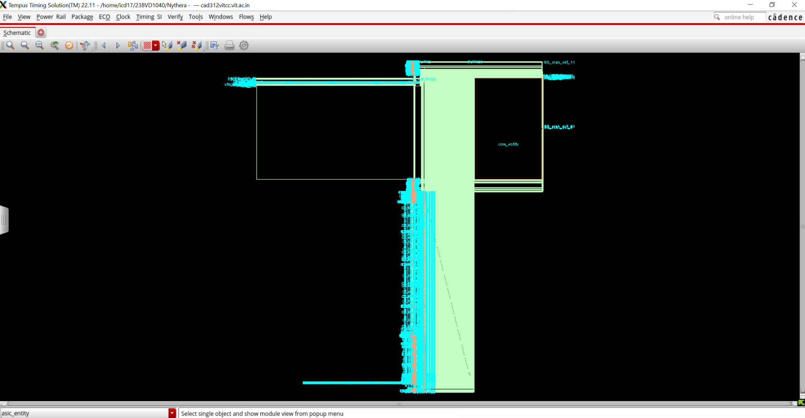
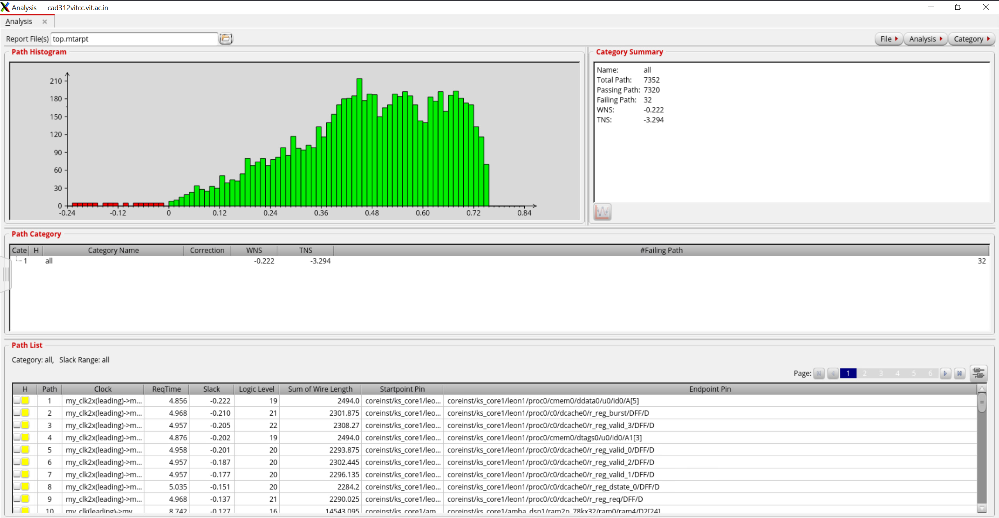
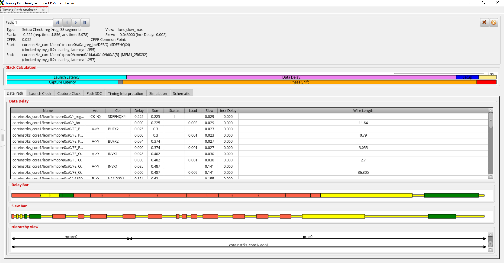
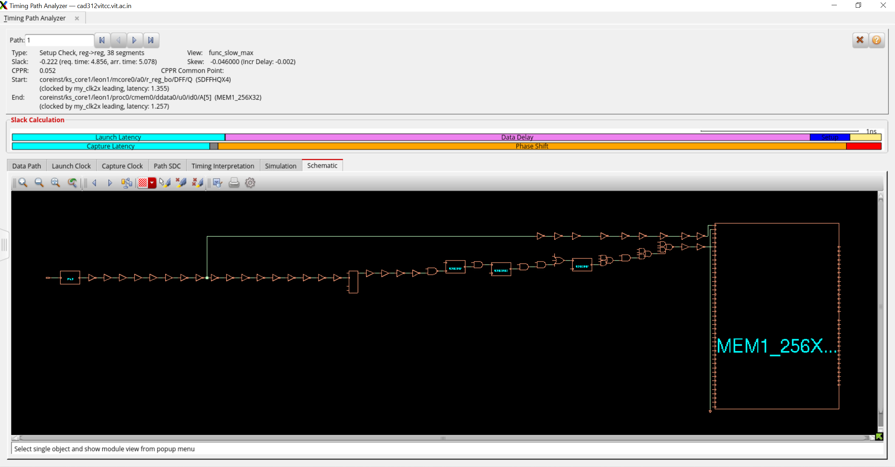
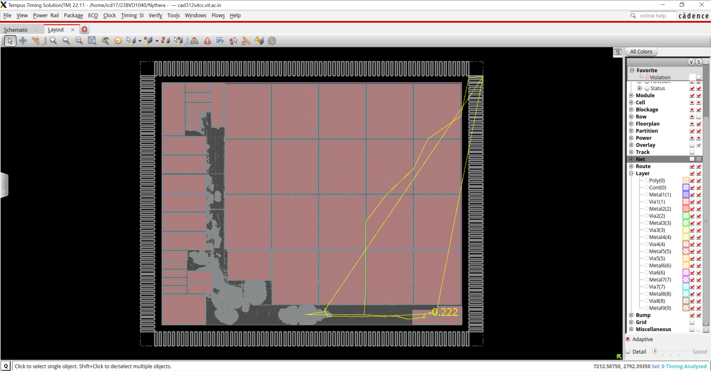

# Nythera
## Global Timing Debug and Timing Closure Analysis

**Engineer:** Jairus Samraj Solomon  
**Project:** Nythera

## Overview

Nythera focuses on timing analysis, timing path investigation, path categorization, and physical timing debug of a post-CTS design using a Global Timing Debug workflow. The objective was to identify setup violations, analyze critical timing paths, correlate timing failures with physical layout information, and study potential optimization opportunities.

---

## Design Initialization and Timing Environment

The design database was restored and timing was updated. Physical information was loaded to enable correlation between timing paths and layout geometry. Machine-readable timing reports were generated and loaded into the timing analysis environment for debugging.

---

## Screenshot 1 – Critical Path Schematic View

### Description
This schematic shows the complete logic traversal of a critical setup path. The path begins at a launching register, propagates through multiple stages of combinational logic and buffering, and terminates at a memory interface endpoint.

### Observations
- Large numbers of buffers are present along the path.
- Multiple logic stages contribute to cumulative delay.
- The endpoint is a memory macro interface.
- The path demonstrates significant combinational depth.

### Significance
The schematic view provides a quick understanding of the logical structure of the critical path and helps identify excessive buffering, logic depth, and endpoint loading effects.

---

## Screenshot 2 – Timing Debug Report Analysis

### Description
The timing debug report presents a histogram of path slack distribution and a categorized list of timing paths.

### Results
- Total Paths: 7352
- Passing Paths: 7320
- Failing Paths: 32
- WNS: -0.222 ns
- TNS: -3.294 ns

### Observations
- Most paths meet timing requirements.
- A small set of paths violate setup timing.
- Violations are concentrated near the negative slack region.

### Significance
The histogram quickly identifies the severity and distribution of timing violations, enabling focus on the most critical paths first.

---

## Screenshot 3 – Timing Path Analyzer

### Description
The Timing Path Analyzer was used to investigate the worst setup violation in detail.

### Path Characteristics
- Setup Check
- Register-to-Register Path
- Slack: -0.222 ns
- View: func_slow_max

### Analysis
The analyzer provides:
- Cell delays
- Net delays
- Slew information
- Load information
- Wire lengths
- Hierarchical traversal

### Significance
This view enables root-cause analysis of timing failures and helps determine whether violations originate from logic delay, routing delay, fanout, or loading effects.

---

## Screenshot 4 – Detailed Schematic Traversal

### Description
The schematic representation of the critical path highlights all gates and interconnects between launch and capture points.

### Observations
- Numerous buffer stages exist along the path.
- Delay accumulation occurs across both cells and interconnects.
- Memory access logic contributes significantly to the overall path delay.

### Significance
Detailed path visualization simplifies identification of optimization opportunities such as buffering changes, logic restructuring, and placement improvements.

---

## Screenshot 5 – Physical Timing Correlation

### Description
The critical timing path is highlighted directly on the physical layout using flight-line visualization.

### Observations
- Long physical traversal is visible across the floorplan.
- The highlighted path spans large placement regions.
- Slack value displayed on the layout is approximately -0.222 ns.
- Physical distance contributes noticeably to routing delay.

### Significance
Physical correlation is essential because timing violations are often influenced by placement and routing effects rather than logic alone. Visualizing the failing path on the floorplan helps identify congestion regions, excessive routing detours, and placement inefficiencies.

---

## Timing Debug Methodology

The following workflow was followed:

1. Load design database and timing environment.
2. Generate machine-readable timing reports.
3. Analyze slack distribution using path histograms.
4. Identify worst failing paths.
5. Investigate timing paths using Timing Path Analyzer.
6. Review path constraints and timing interpretation.
7. Examine schematic representation of critical paths.
8. Correlate timing failures with physical layout.
9. Categorize violations for systematic debugging.
10. Evaluate timing improvement opportunities through buffering and path optimization.

---

## Key Findings

- The design is largely timing clean, with only a small number of violating paths.
- Worst Negative Slack (WNS) is limited to -0.222 ns.
- Total Negative Slack (TNS) remains relatively small.
- Critical violations are associated with long data paths and memory-related logic.
- Physical distance and routing contribute significantly to delay accumulation.
- Timing debug visualization greatly accelerates root-cause identification.

---

## Conclusion

Nythera demonstrates a complete timing-debug workflow from report generation to physical timing correlation. The analysis identified a limited set of setup violations, with the worst path exhibiting a slack of -0.222 ns. Through schematic analysis, timing-path investigation, and floorplan-based visualization, the root causes of timing degradation were isolated and understood. The project establishes a structured methodology for timing closure and post-CTS timing optimization in complex digital designs.
